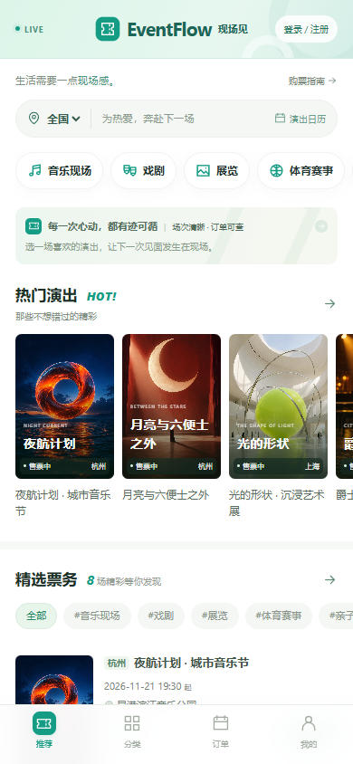
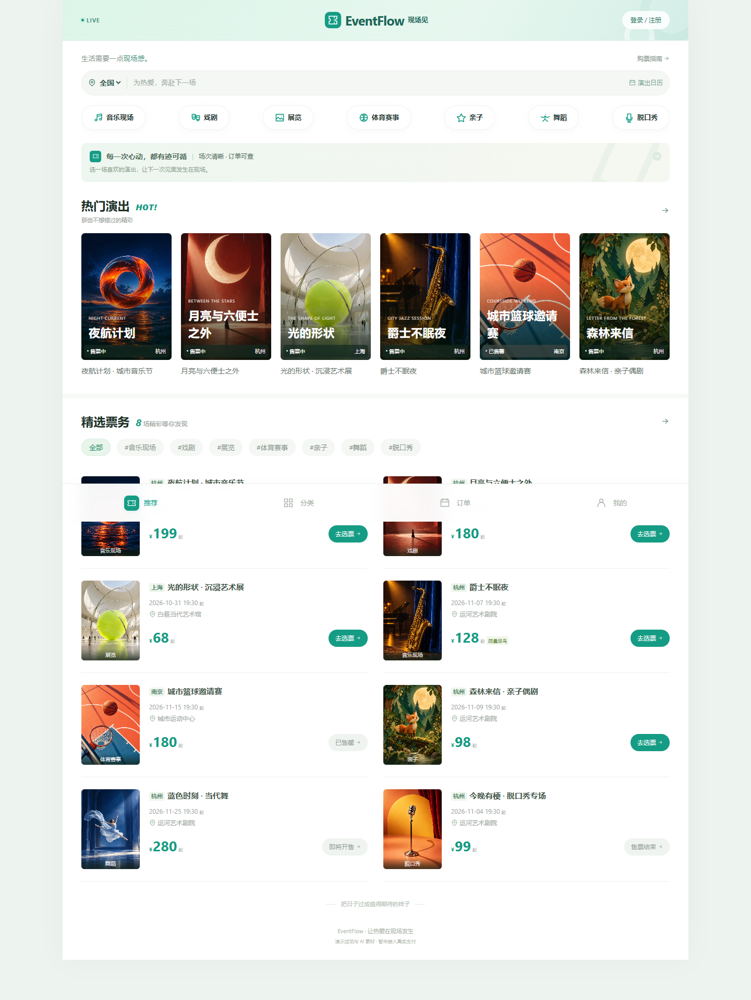
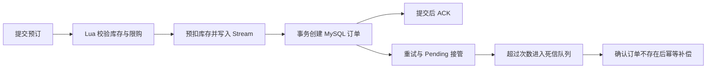

# EventFlow · 现场见

基于 Spring Boot、MySQL 和 Redis 的票务与场馆预约练习项目，支持演出浏览、场次选票、普通票及限量票预订、订单查询和现场内容分享。重点实践 Redis Lua 原子预扣、Streams 异步订单和失败补偿。

前端采用 Vue 2，手机优先，电脑访问时扩展布局；薄荷绿配色，静态页面直接由 Spring Boot 提供，无需单独启动前端服务。当前界面不提供搜索入口。

> 当前为学习与演示版本。验证码在演示模式下直接显示，未接入真实短信、支付、退款、在线选座和验票；没有公开的并发性能基准数据。

## 页面预览



<details>
<summary>查看电脑版布局</summary>



</details>

## 功能概览

| 模块 | 已实现能力 |
| --- | --- |
| 演出与场馆 | 活动分类、城市与日期筛选、演出详情、场次和票档、场馆列表与详情 |
| 票务预订 | 普通票下单、限量票抢购、同票档限购、售票时间及库存校验 |
| 订单 | 异步处理状态查询、本人订单列表与详情、订单归属校验 |
| 用户 | 演示验证码登录、Token 鉴权、资料编辑、退出登录 |
| 内容互动 | 活动分享、图片上传、点赞、关注与 Feed 流相关接口 |
| Redis 扩展 | GEO 场馆位置索引、Bitmap 签到、Sorted Set 点赞与动态排序 |
| 部署 | Docker Compose、本地启动脚本、数据库与 Redis 迁移工具 |

## 限量票处理流程



- **原子预扣**：Lua 完成库存检查、用户限购、库存预扣及消息投递。
- **异步落库**：消费者组通过 ACK、Pending List 和 `XAUTOCLAIM` 恢复未完成消息。
- **失败补偿**：死信消费者确认 MySQL 中不存在订单，再恢复 Redis 库存与限购标记。
- **库存对账**：Redisson 锁避免多个实例同时对账。缺失库存键可初始化，已有库存差异记录告警，不直接覆盖。

这些机制用于实践最终一致性，不代表已经完成生产规模的压力验证。

## 技术栈

| 层次 | 技术 |
| --- | --- |
| 后端 | Java 8、Spring Boot 2.3.12、MyBatis-Plus 3.4.3 |
| 数据与消息 | MySQL 8.0、Redis 7.2、Redis Streams、Lua、Redisson |
| 前端 | Vue 2、Axios、HTML / CSS、WebP 图片 |
| 构建与部署 | Maven、Docker、Docker Compose |
| 验证 | JUnit 5、Spring Boot 集成测试、Node.js 接口检查、Playwright 页面检查 |

## 本地启动

准备 JDK 8、Maven 3.6+ 和 Docker Compose。Windows 可以使用 Docker Desktop，并将 `JAVA_HOME` 指向 JDK 安装目录。

这是源码仓库，不附带 JAR、Maven 程序或真实 `.env`。运行前请确认 `java -version`、`mvn -version` 和 `docker info` 均正常；首次启动还需要网络下载依赖与镜像。`compose.local.yaml` 只启动数据库和 Redis，后端仍需通过 IDEA、Maven 或启动脚本运行。

### Windows 启动脚本

在项目根目录执行：

```powershell
.\start-local.cmd -Build
```

脚本会启动 MySQL 和 Redis、编译后端并打开首页。之后启动已有 JAR 可运行 `.\start-local.cmd`；修改 Java 后使用 `-Build` 重新编译。首次启动需要下载依赖和容器镜像。

### IDEA 或命令行

先启动依赖容器：

```bash
docker compose -p eventflow-desktop-qa -f compose.local.yaml up -d
```

等待 MySQL 首次初始化完成，再运行启动类 `com.eventflow.EventFlowApplication`，或执行：

```bash
mvn -DskipTests package
java -jar target/eventflow-ticketing-0.0.1-SNAPSHOT.jar
```

未指定 Spring Profile 时，加载 `application-default.yaml` 中的本地演示配置。

| 服务 | 本地地址 | 说明 |
| --- | --- | --- |
| 网站与后端 | `http://localhost:8082/` | 前后端使用同一端口 |
| MySQL | `127.0.0.1:23306` | 数据库 `eventflow_desktop`，用户 `root` |
| Redis | `127.0.0.1:26379` | 仅绑定本机地址 |

本地 MySQL 和 Redis 的演示密码均为 `eventflow-qa-local`，仅用于 `compose.local.yaml` 提供的本地环境。服务器通过环境变量配置独立凭证。

首次创建 MySQL 数据卷时自动导入 `src/main/resources/db/eventflow.sql`，生成 8 个虚构演出、4 个场馆及相关场次票档。演出时间按初始化当天计算。已有数据库升级使用增量脚本，不要用全量初始化 SQL 覆盖已有订单。

Windows 停止脚本启动的应用：

```powershell
powershell -ExecutionPolicy Bypass -File .\stop-local.ps1
```

加 `-WithDependencies` 可同时停止本地依赖容器，数据卷会保留。IDEA 启动的应用使用 IDEA 的停止按钮关闭。

## 页面与接口

常用页面：`/`、`/events.html`、`/login.html`、`/orders.html`、`/info.html` 和 `/community.html`。

| 接口 | 用途 |
| --- | --- |
| `GET /events` | 演出列表与筛选 |
| `GET /events/{id}` | 演出、场次及票档详情 |
| `GET /events/venues` | 场馆列表 |
| `POST /user/code` | 获取演示验证码 |
| `POST /user/login` | 登录并取得 Token |
| `POST /booking/orders` | 提交预订，参数为 `ticketId` |
| `GET /booking/orders` | 查询本人订单 |
| `GET /booking/orders/{id}` | 查询订单及异步处理状态 |
| `PUT /user/profile` | 编辑资料 |
| `POST /user/logout` | 注销当前 Token |

受保护接口使用请求头 `authorization: <token>`，不添加 `Bearer` 前缀。演示验证码由 `/user/code` 响应中的 `data.demoCode` 返回，登录页会显示。

`apifox-openapi.yaml` 可导入 Apifox，主要覆盖原有用户、场馆和内容接口；新增演出与预订接口以控制器及上表为准。

## 验证方式

先准备独立的本地 MySQL 和 Redis，再运行：

```bash
mvn test
```

测试包含应用与数据读取、OpenAPI YAML 格式、Streams 重复消息处理、死信幂等补偿和库存对账。集成测试会创建测试数据，应在开发环境运行。

可选的接口检查需要 Node.js 20+ 和正在运行的演示应用：

```bash
node scripts/check_backend.cjs
```

页面检查还需要 Playwright 和 Google Chrome：

```bash
npm install --no-save --package-lock=false playwright
node scripts/review_mobile.cjs
```

结果写入 `output/`；接口检查会创建测试账号和订单。`legacy/jmeter/` 是旧版本压测资料，尚未适配当前接口，不用于证明本版本的并发性能。

## 目录结构

```text
EventFlow/
├── src/main/java/com/eventflow/     # 控制器、服务、实体、Mapper 与 Redis 工具
├── src/main/resources/
│   ├── db/                         # 初始化与增量 SQL
│   ├── static/                     # 页面、脚本、样式和图片
│   ├── application*.yaml           # 基础与本地配置
│   └── *.lua                       # 预扣、补偿与解锁脚本
├── src/test/                       # Java 集成测试
├── scripts/                        # 开发检查、素材生成与迁移工具
├── design/                         # 虚构演出数据与 AI 图片提示词
├── docs/                           # 页面截图和部署说明
├── legacy/jmeter/                  # 历史压测资料
├── compose.local.yaml              # 本地 MySQL / Redis
├── compose.yaml                    # 服务器应用及依赖
└── Dockerfile                      # 已编译 JAR 的运行镜像
```

## 部署与配置

服务器使用 `production` Profile，通过 `DB_URL`、`DB_USER`、`DB_PASSWORD`、`REDIS_HOST`、`REDIS_PORT`、`REDIS_PASSWORD` 和 `EVENTFLOW_UPLOAD_DIR` 等环境变量连接依赖。`.env.example` 只提供字段示例，真实 `.env` 不进入仓库。

完整操作见 [部署指南](docs/DEPLOYMENT.md)。AI 图片与提示词位于 `src/main/resources/static/imgs/eventflow/` 和 `design/assets-prompts.json`；演出内容均为演示素材。
